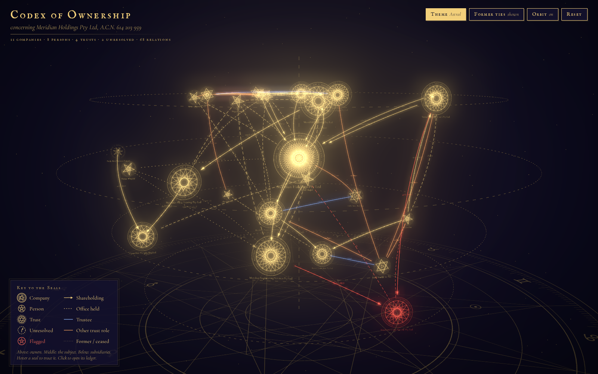
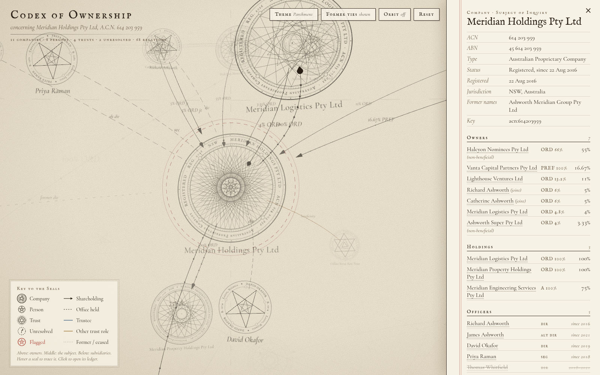
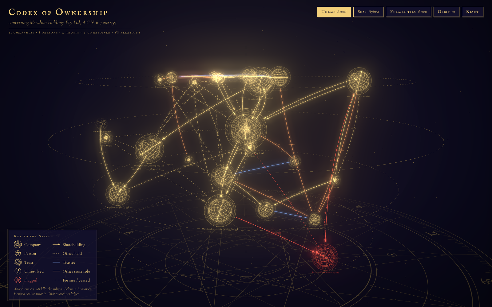
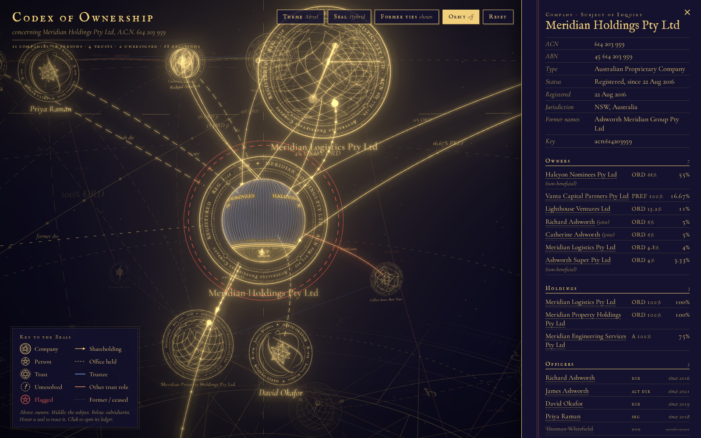

# Codex of Ownership

A three.js proof of concept that shows a company ownership structure (companies, shareholders, directors and trusts) in 3D, styled as an occult diagram.




## Run

```
python3 -m http.server 8765
```

Then open http://localhost:8765/. Add `?scratch` to the URL to use the alternative stub dataset.

## What it shows

- **Seals by entity type.** Companies have a dense star-polygon web; the target company is the largest. People are pentagrams. Trusts are hexagrams inside a double circle. Unresolved organisations are dashed rings with a "?". A flagged entity is drawn in red.
- **Ownership depth on the vertical axis.** Ultimate owners are at the top, the target company in the middle and subsidiaries below.
- **Relationship styles.** Shareholdings are drawn with arrows, percentage and share-class labels, and particles flowing along them. Officer links are dashed. Trust roles are drawn in colour. Former and ceased ties are faint, and a toggle hides them.
- **Interaction.**
  - Hover over a seal to trace its connections.
  - Click a seal to open a ledger panel showing its owners, holdings, officers and trust roles.
- **Themes.** Parchment, or Astral (gold on indigo, with bloom).
- **Seal styles.** The **Seal** button cycles Flat → Armillary → String-art → Cap-table → Hybrid in place, keeping the camera, selection and theme. `?seal=<name>` deep-links a style and `?theme=astral` the theme, e.g. `?seal=hybrid&theme=astral`. See `seals/README.md`.




## Data

`data.js` is a fictional Australian corporate group: companies, people, trusts and unresolved organisations, linked by shareholdings, officeholdings and trust roles. `SCHEMA.md` describes the format.
